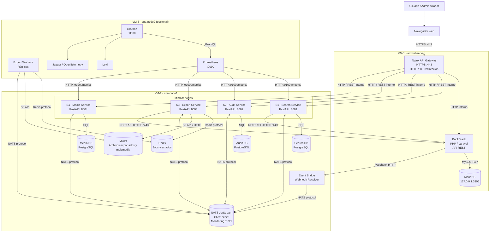

# C4 - Diagrama de Contenedores

## Sistema BookStack Cloud Native

Este diagrama representa la arquitectura objetivo distribuida en tres nodos, incluyendo contenedores, tecnologías, puertos y protocolos de comunicación.



## Descripción de los nodos

| Nodo | Componentes | Responsabilidad |
|---|---|---|
| VM-1 | Nginx, BookStack, MariaDB | Gateway TLS y sistema monolítico legado. |
| VM-2 | Event Bridge, S1, S2, S3, S4, NATS, Redis y almacenes | Ejecutar los microservicios y gestionar eventos y datos. |
| VM-3 | Workers, Prometheus, Grafana, Loki y Jaeger | Procesamiento adicional y observabilidad. |

## Puertos y protocolos

| Componente | Puerto | Protocolo |
|---|---:|---|
| Nginx Gateway | 443 | HTTPS |
| Nginx redirección | 80 | HTTP |
| SSH de administración | 22 | SSH |
| BookStack | Interno | HTTP / PHP-FPM |
| MariaDB | 3306 | MySQL |
| Search Service | 8001 | HTTP REST |
| Audit Service | 8002 | HTTP REST |
| Export Service | 8003 | HTTP REST |
| Media Service | 8004 | HTTP REST |
| NATS JetStream | 4222 | NATS |
| NATS Monitoring | 8222 | HTTP |
| Redis | 6379 | Redis |
| MinIO API | 9000 | S3 API / HTTP |
| Prometheus | 9090 | HTTP |
| Grafana | 3000 | HTTP |

## Responsabilidades de los servicios

- **S1 Search:** indexación y búsqueda de páginas y libros.
- **S2 Audit:** registro de actividad y auditoría mediante eventos.
- **S3 Export:** generación de exportaciones mediante trabajos asíncronos.
- **S4 Media:** gestión de imágenes y archivos adjuntos.

## Reglas de comunicación

1. Todo el tráfico externo ingresa por HTTPS en el puerto 443 de VM-1.
2. El puerto 80 se utiliza únicamente para redirección HTTP a HTTPS.
3. BookStack no se modifica: la integración utiliza Webhooks y API REST.
4. Los servicios S1 y S3 consultan datos del monolito mediante su API REST.
5. Los microservicios no acceden directamente a MariaDB.
6. Cada servicio mantiene la propiedad de sus propios datos.
7. NATS JetStream permite la comunicación asíncrona y la entrega durable de eventos.
8. Los puertos internos no se exponen directamente a Internet.

## Consideraciones

La arquitectura representa el diseño objetivo del proyecto. Los puertos y conexiones internas deberán confirmarse durante la implementación y el despliegue.

VM-3 es opcional y puede fusionarse con VM-2 cuando los recursos disponibles sean limitados.
```

Guardá con `Ctrl + S`.

**Una aclaración importante:** los puertos indicados para los servicios son puertos internos propuestos, no puertos que debamos abrir en el firewall de Internet. La regla del TP sigue siendo que el acceso externo entre por 443 (y 80 únicamente para redirección).

Cuando termines, revisaremos el C4 de contexto y luego generaremos las evidencias F5-E5, F5-E6 y F5-E7.