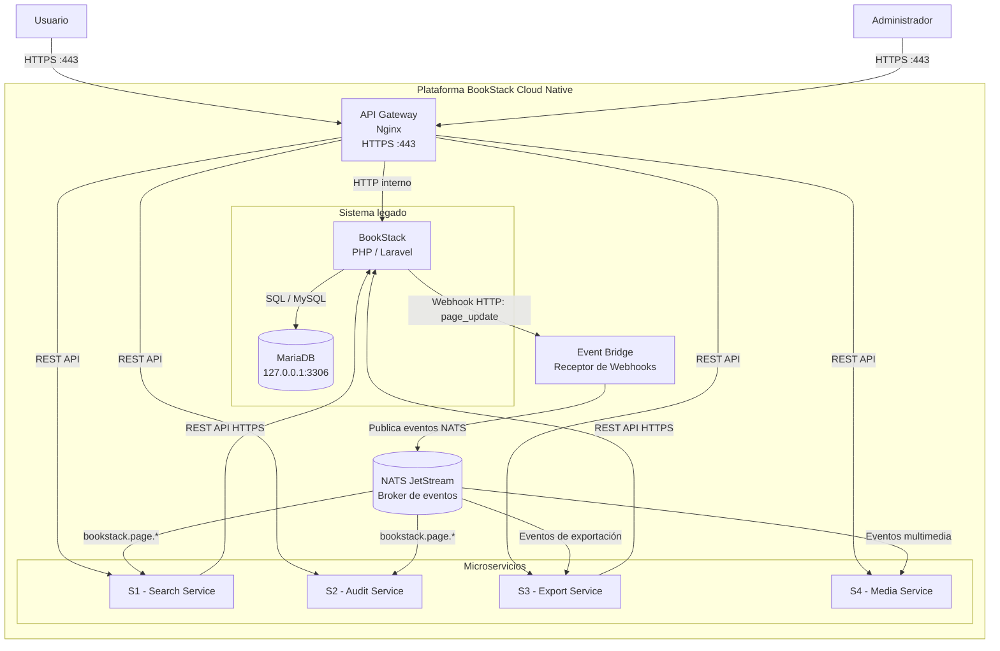

# C4 - Nivel 1: Diagrama de Contexto

## Sistema BookStack Cloud Native

### Descripción

La solución evoluciona BookStack desde una arquitectura monolítica hacia una arquitectura distribuida mediante el patrón Strangler Fig.

BookStack continúa funcionando como sistema principal, mientras cuatro microservicios extraen progresivamente las funcionalidades de búsqueda, auditoría, exportación y gestión de medios.

La integración se realiza mediante la API REST y Webhooks existentes de BookStack, sin modificar su código fuente.

## Diagrama de contexto



## Actores

| Actor | Responsabilidad |
|---|---|
| Usuario | Consulta, crea y modifica contenido de BookStack. |
| Administrador | Administra la plataforma y sus funcionalidades. |

## Sistemas y componentes

| Componente | Responsabilidad |
|---|---|
| API Gateway | Punto de entrada HTTPS y enrutamiento de solicitudes. |
| BookStack | Sistema monolítico que conserva las funcionalidades originales. |
| MariaDB | Base de datos del sistema legado. |
| Event Bridge | Recibe Webhooks de BookStack y publica eventos en el broker. |
| NATS JetStream | Gestiona la comunicación asíncrona y la entrega durable de eventos. |
| Search Service | Extrae las funcionalidades de búsqueda e indexación. |
| Audit Service | Registra y consulta eventos de auditoría. |
| Export Service | Gestiona la generación de exportaciones. |
| Media Service | Gestiona imágenes y archivos adjuntos. |

## Relaciones y protocolos

| Origen | Destino | Protocolo | Propósito |
|---|---|---|---|
| Usuario | API Gateway | HTTPS :443 | Acceso a la plataforma. |
| Administrador | API Gateway | HTTPS :443 | Administración. |
| API Gateway | BookStack | HTTP interno | Acceso al monolito. |
| API Gateway | Microservicios | REST API | Solicitudes síncronas. |
| BookStack | Event Bridge | Webhook HTTP | Notificación de cambios. |
| Search Service | BookStack | REST API HTTPS | Consulta de páginas para indexación. |
| Export Service | BookStack | REST API HTTPS | Obtención de contenido para exportar. |
| Event Bridge | NATS JetStream | NATS | Publicación de eventos. |
| NATS JetStream | Microservicios | NATS | Distribución de eventos. |

## Decisiones arquitectónicas

1. Se utiliza el patrón Strangler Fig para extraer funcionalidades progresivamente.
2. BookStack permanece operativo durante todo el proceso de migración.
3. No se modifica el código fuente de BookStack.
4. BookStack notifica cambios mediante Webhooks.
5. Search y Export consultan los datos del monolito mediante API REST.
6. Los eventos se distribuyen mediante NATS JetStream.
7. Los microservicios no acceden directamente a MariaDB.
8. El API Gateway centraliza el tráfico externo mediante HTTPS.

## Consideraciones

Este diagrama representa la arquitectura objetivo (To Be), no una infraestructura ya desplegada.

La extracción de funcionalidades se realizará progresivamente, manteniendo el funcionamiento del sistema monolítico.
```

Guardá con `Ctrl + S`.

---

## Paso 3. Estado de los diagramas A4

Cuando guardes, tendremos estos archivos:

| Archivo | Contenido |
|---|---|
| `c4_contexto.md` | C4 nivel 1 |
| `c4_contenedores.md` | C4 nivel 2 |
| `diagramas_secuencia.md` | Tres interacciones obligatorias y sus errores |

El TP solicita estos tres entregables como evidencias F5-E5, F5-E6 y F5-E7. <FileCite ref_id="turn34file1" />

**Después de guardar**, vamos a comprobar que Mermaid pueda representar correctamente los diagramas y preparar las capturas. Todavía no hagas commit.