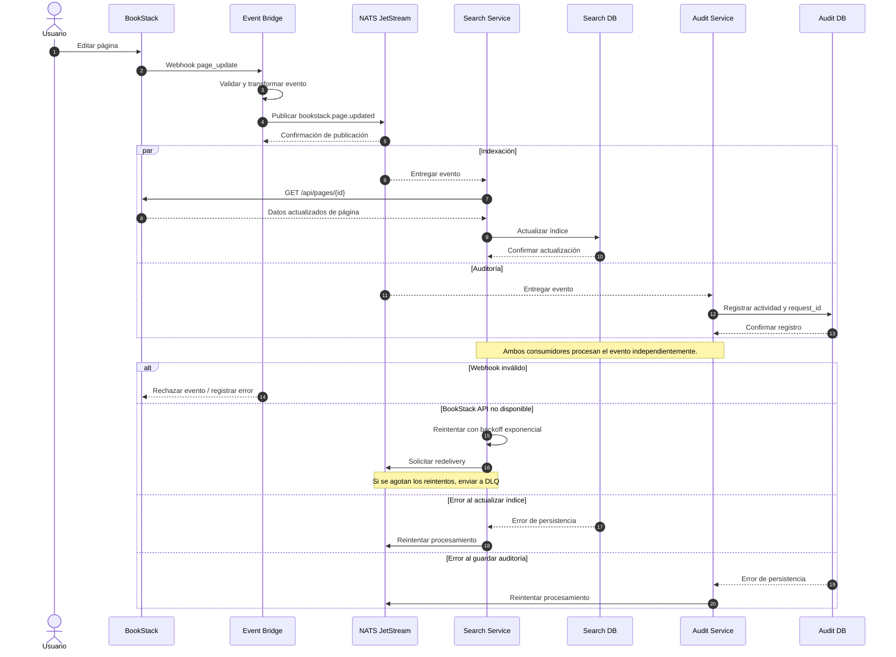
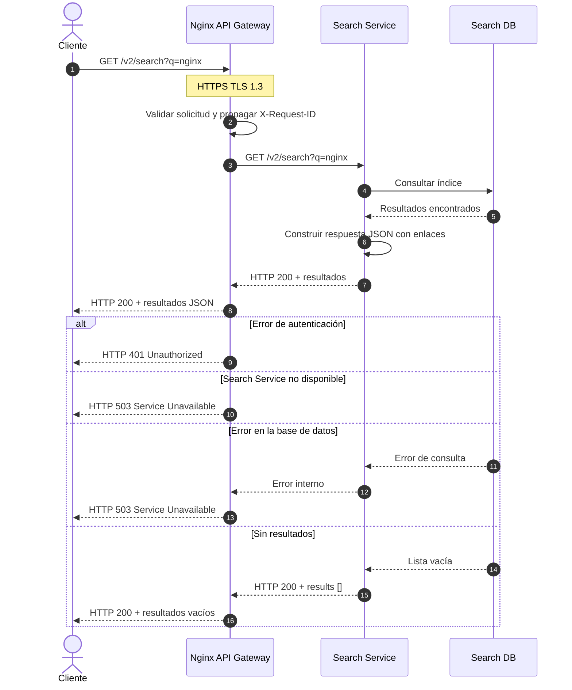
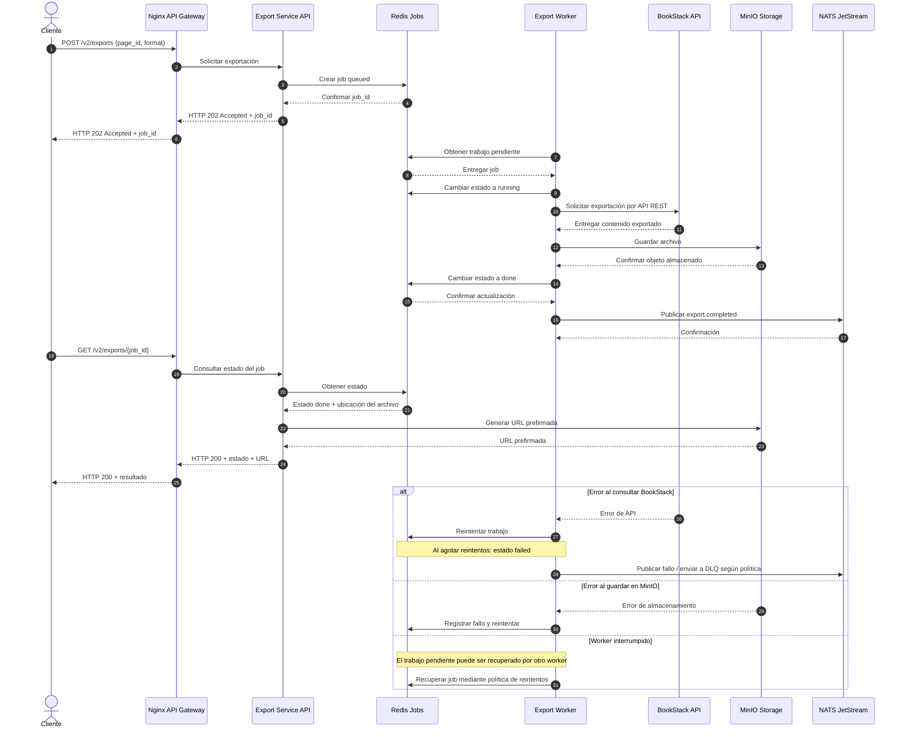

# Diagramas de Secuencia - BookStack Cloud Native

Los siguientes diagramas representan las tres interacciones obligatorias definidas en la sección 3.4 del TP Integrador II. Cada interacción incluye su flujo normal y sus caminos de error.

---

# 1. Edición e indexación asíncrona

## Descripción

Cuando un usuario edita una página en BookStack, el monolito dispara el Webhook `page_update`. El Event Bridge publica el evento `bookstack.page.updated` en NATS JetStream. Search Service (S1) consume el evento, consulta la API REST de BookStack y actualiza el índice. Audit Service (S2) consume el mismo evento y registra la auditoría.

---

# 2. Búsqueda síncrona

## Descripción

El cliente realiza una búsqueda a través del gateway HTTPS. El gateway dirige la solicitud al Search Service (S1), que consulta su almacén de búsqueda y devuelve resultados JSON con enlaces a las páginas originales de BookStack.

---

# 3. Exportación asíncrona mediante trabajos

## Descripción

El cliente solicita una exportación mediante `POST /v2/exports`. S3 devuelve `202 Accepted` y un `job_id`. Un worker independiente toma el trabajo, solicita la exportación a BookStack mediante su API REST, guarda el archivo en MinIO y actualiza el estado del trabajo. El cliente consulta el resultado mediante `GET /v2/exports/{job_id}`.

---

# Consideraciones generales

- Las tres interacciones siguen los flujos obligatorios de la sección 3.4.
- La edición e indexación es asíncrona y utiliza Webhooks y NATS JetStream.
- La búsqueda es síncrona y pasa por el API Gateway.
- La exportación utiliza trabajos independientes y responde inicialmente con HTTP 202.
- Los servicios propagan `X-Request-ID` y el campo `request_id` de los eventos.
- Los consumidores implementan idempotencia mediante `event_id`.
- Los mensajes fallidos contemplan reintentos y Dead Letter Queue (DLQ).
- Los microservicios no acceden directamente a MariaDB de BookStack.
