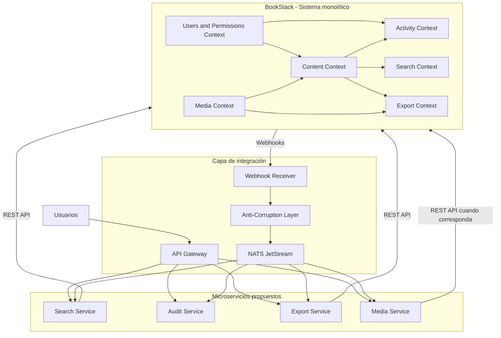

# F5-E3 - Mapa de contextos DDD de BookStack

## 1. Objetivo

Identificar los contextos delimitados (Bounded Contexts) de BookStack y sus relaciones, como base para una futura separación progresiva hacia una arquitectura de microservicios.

La estrategia propuesta es Strangler Fig: BookStack continuará funcionando como sistema principal mientras se extraen funcionalidades progresivamente.

Los contextos delimitados representan límites funcionales y no necesariamente servicios independientes en la implementación actual.

## 2. Contextos delimitados

### 2.1 Content Context

Responsabilidad:

- Administrar estanterías, libros, capítulos y páginas.
- Gestionar revisiones y estructura del contenido.
- Mantener las relaciones entre las entidades.
- Administrar etiquetas, comentarios y referencias asociadas al contenido.

Tablas principales:

- `entities`
- `entity_container_data`
- `entity_page_data`
- `page_revisions`
- `bookshelves_books`
- `tags`
- `comments`
- `references`
- `slug_history`
- `sort_rules`
- `deletions`

Este contexto representa el núcleo funcional de BookStack.

### 2.2 Search Context

Responsabilidad:

- Indexar contenido.
- Procesar términos de búsqueda.
- Permitir búsquedas por texto y etiquetas.
- Mantener un índice de búsqueda independiente.

Tablas principales:

- `search_terms`
- `entities`
- `entity_container_data`
- `entity_page_data`
- `tags`

Microservicio propuesto: Search.

El servicio Search obtendrá la información necesaria mediante las interfaces de integración con BookStack y mantendrá su propio almacenamiento para los índices.

### 2.3 Activity Context

Responsabilidad:

- Registrar actividades realizadas por los usuarios.
- Mantener información de auditoría.
- Asociar los eventos registrados con los usuarios y recursos involucrados.

Tabla principal:

- `activities`

Tablas relacionadas:

- `users`
- `entities`

La tabla `activities` utiliza los campos `loggable_id` y `loggable_type` para representar relaciones polimórficas con diferentes recursos.

Otras funcionalidades relacionadas con seguimiento y participación, como visualizaciones, comentarios, favoritos y notificaciones, deben analizarse como responsabilidades diferenciadas antes de incorporarlas al servicio de auditoría.

Microservicio propuesto: Audit.

### 2.4 Export Context

Responsabilidad:

- Exportar libros, capítulos y páginas.
- Incluir etiquetas, imágenes y archivos adjuntos.
- Generar paquetes de exportación.
- Gestionar el estado de las solicitudes de exportación.

Tablas consultadas por los procesos de exportación:

- `entities`
- `entity_container_data`
- `entity_page_data`
- `page_revisions`
- `tags`
- `images`
- `attachments`

Microservicio propuesto: Export.

El servicio deberá obtener los datos de BookStack mediante REST API y administrar independientemente los trabajos y resultados de exportación.

### 2.5 Media Context

Responsabilidad:

- Administrar imágenes.
- Administrar archivos adjuntos.
- Gestionar referencias a archivos y su almacenamiento.
- Proporcionar acceso controlado a los recursos multimedia.

Tablas principales:

- `images`
- `attachments`

Tablas relacionadas:

- `entities`
- `joint_permissions`

Microservicio propuesto: Media.

El servicio administrará sus propios datos y almacenamiento, evitando depender directamente de las tablas de MariaDB de BookStack.

### 2.6 Users and Permissions Context

Responsabilidad:

- Administrar usuarios y roles.
- Gestionar permisos globales y por entidad.
- Controlar el acceso a funcionalidades y contenidos.
- Administrar mecanismos de autenticación y autorización.

Tablas principales:

- `users`
- `roles`
- `role_user`
- `role_permissions`
- `permission_role`
- `entity_permissions`
- `joint_permissions`

Tablas relacionadas:

- `api_tokens`
- `sessions`
- `mfa_values`
- `social_accounts`
- `user_invites`
- `email_confirmations`
- `password_resets`

Este contexto permanece inicialmente dentro del monolito BookStack. Los servicios externos deberán respetar los mecanismos de autenticación y autorización definidos para la integración.

## 3. Relaciones entre contextos

Las principales relaciones identificadas son:

- Content proporciona información a Search para construir y actualizar el índice de búsqueda.
- Search depende de los datos de contenido y etiquetas administrados por BookStack.
- Activity registra acciones relacionadas con usuarios y entidades de Content.
- Export consume información de Content y referencias a Media para generar paquetes de exportación.
- Media administra los archivos relacionados con el contenido.
- Users and Permissions proporciona información de identidad y autorización a los demás contextos.

Estas relaciones representan dependencias funcionales que deberán resolverse mediante contratos de integración y no mediante acceso directo a tablas compartidas.

## 4. Estrategia de integración

La integración entre BookStack y los nuevos microservicios se realizará exclusivamente mediante REST API y Webhooks.

No se modificará el código fuente de BookStack.

La arquitectura propuesta contempla:

- API Gateway como punto de entrada para las solicitudes dirigidas a los microservicios.
- Un componente de integración para recibir y adaptar los Webhooks de BookStack.
- NATS JetStream como broker de mensajería para la comunicación asíncrona.
- API REST de BookStack para consultar información del monolito.
- Bases de datos independientes para cada microservicio.
- Una capa anticorrupción (Anti-Corruption Layer) para adaptar los modelos y contratos de BookStack a los modelos internos de los nuevos servicios.

Los microservicios no accederán directamente a la base de datos MariaDB de BookStack.

## 5. Mapa de contextos

El diagrama representa la arquitectura objetivo y las relaciones propuestas. No significa que los microservicios ya estén implementados.

## 6. Relaciones DDD y decisiones de integración

| Contexto origen | Contexto destino | Relación propuesta |
|---|---|---|
| Content | Search | Customer/Supplier |
| Content | Activity | Customer/Supplier |
| Content | Export | Customer/Supplier |
| Content | Media | Customer/Supplier |
| Users and Permissions | Content | Customer/Supplier |
| Users and Permissions | Activity | Customer/Supplier |

Se propone utilizar una capa anticorrupción (Anti-Corruption Layer) para adaptar los modelos, identificadores y contratos de BookStack a los modelos internos de los nuevos microservicios.

La comunicación asíncrona se realizará mediante eventos publicados en NATS JetStream.

Los servicios consumidores deberán implementar mecanismos de idempotencia, reintentos y recuperación ante fallos.

## 7. Consideraciones arquitectónicas

- Los contextos representan límites funcionales propuestos; no implican que actualmente existan como servicios independientes.
- La extracción será incremental mediante la estrategia Strangler Fig.
- Las tablas compartidas identificadas en F5-E2 no serán compartidas directamente entre microservicios.
- La integración con BookStack se realizará mediante REST API y Webhooks.
- Cada microservicio administrará sus propios datos.
- La sincronización de información se realizará mediante contratos y eventos.
- Se deberá contemplar consistencia eventual, idempotencia y mecanismos de recuperación.
- Users and Permissions permanecerá inicialmente dentro de BookStack.
- La capa anticorrupción permitirá desacoplar los modelos internos del monolito de los nuevos servicios.

## 8. Conclusión

El análisis DDD permite identificar seis contextos funcionales dentro de BookStack y reconocer sus principales dependencias.

La arquitectura propuesta contempla la extracción progresiva de Search, Audit, Export y Media, manteniendo inicialmente las funcionalidades de contenido y usuarios dentro del monolito.

La utilización de API REST, Webhooks, NATS JetStream y bases de datos independientes permitirá reducir el acoplamiento y avanzar hacia una arquitectura distribuida sin modificar el código fuente de BookStack.

## 9. Evidencia

F5-E3: Mapa de contextos DDD de BookStack.
